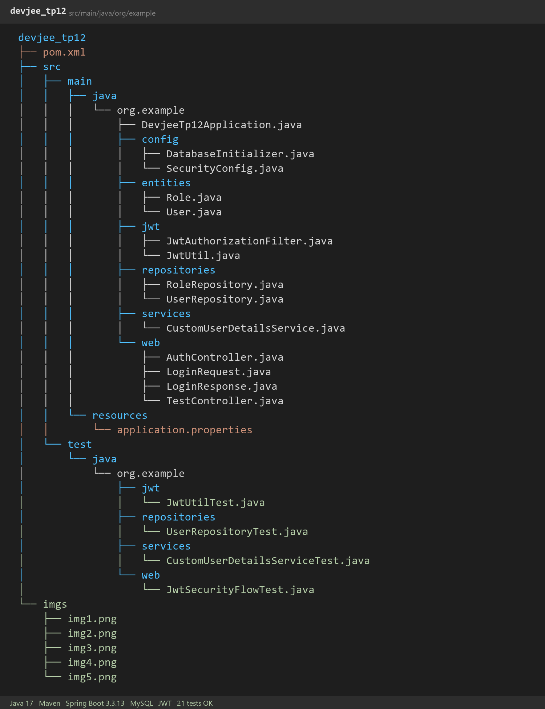
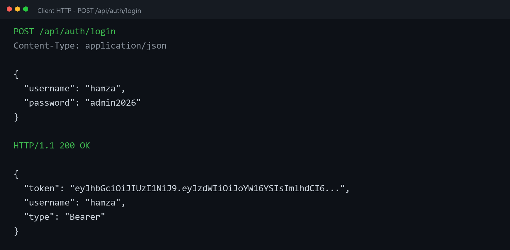
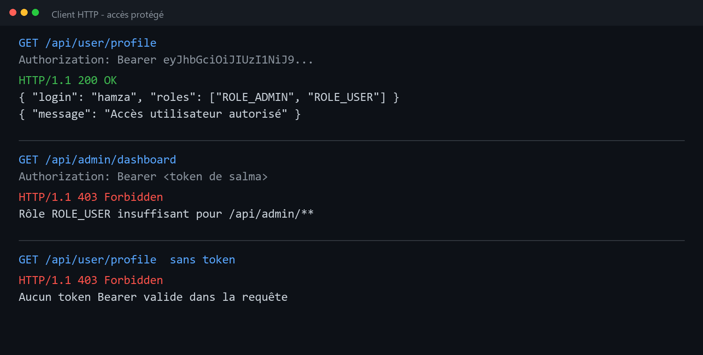
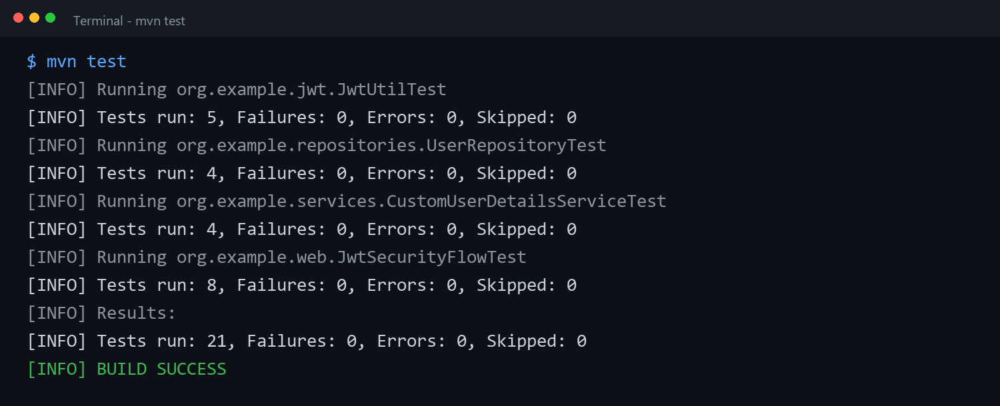
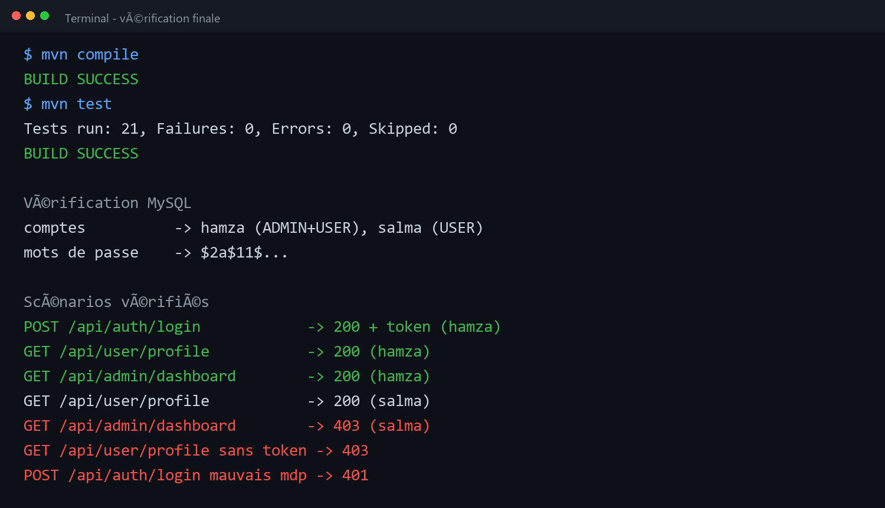

TP 12 Spring Security avec API REST stateless, authentification JWT, filtre d'autorisation, rôles et mots de passe BCrypt stockés dans MySQL.

Structure du projet avec les packages org.example.config, entities, jwt, repositories, services et web, ainsi que les tests JUnit 4.13.2 :

```console
src/main/java/org/example/DevjeeTp12Application.java
src/main/java/org/example/config/DatabaseInitializer.java
src/main/java/org/example/config/SecurityConfig.java
src/main/java/org/example/entities/Role.java
src/main/java/org/example/entities/User.java
src/main/java/org/example/jwt/JwtAuthorizationFilter.java
src/main/java/org/example/jwt/JwtUtil.java
src/main/java/org/example/repositories/RoleRepository.java
src/main/java/org/example/repositories/UserRepository.java
src/main/java/org/example/services/CustomUserDetailsService.java
src/main/java/org/example/web/AuthController.java
src/main/java/org/example/web/LoginRequest.java
src/main/java/org/example/web/LoginResponse.java
src/main/java/org/example/web/TestController.java
src/main/resources/application.properties
src/test/java/org/example/jwt/JwtUtilTest.java
src/test/java/org/example/repositories/UserRepositoryTest.java
src/test/java/org/example/services/CustomUserDetailsServiceTest.java
src/test/java/org/example/web/JwtSecurityFlowTest.java
pom.xml
```

Vue du projet dans IntelliJ avec les entités, le JWT, les repositories, la sécurité et les tests :



Le login vérifie les identifiants en base, génère un token signé en HS256 avec une expiration d'une heure et renvoie le token au client, qui le présentera ensuite en Bearer :

```console
POST /api/auth/login -> 200 + token JWT (hamza)
token                -> header Bearer, signature HS256, expiration 1h
base MySQL           -> securite_jwt
comptes              -> hamza (ADMIN + USER), salma (USER)
mots de passe        -> BCrypt $2a$11$...
```

Capture de la requête de connexion et de la réponse contenant le token :



Le filtre JWT valide le token avant d'alimenter le SecurityContext, les rôles sont contrôlés sur les URLs et une requête sans token valide est refusée :

```console
GET /api/user/profile avec token hamza     -> 200
GET /api/admin/dashboard avec token hamza  -> 200
GET /api/user/profile avec token salma     -> 200
GET /api/admin/dashboard avec token salma  -> 403
GET /api/user/profile sans token           -> 403
POST /api/auth/login mauvais mot de passe  -> 401
```

Capture des accès protégés avec et sans les droits nécessaires :



Compilation et tests avec le JDK de IntelliJ, JUnit 4.13.2, vingt-et-un tests pour le token, les repositories, le chargement des comptes, BCrypt, le filtre JWT et les règles d'accès :

```console
Running org.example.jwt.JwtUtilTest
Running org.example.repositories.UserRepositoryTest
Running org.example.services.CustomUserDetailsServiceTest
Running org.example.web.JwtSecurityFlowTest
Tests run: 21, Failures: 0, Errors: 0, Skipped: 0
```

Capture des tests verts avec les requêtes et les assertions condensées :



Bilan final, compile puis test passent sans erreur, le token est généré et validé, et les restrictions par rôle sont respectées :

```console
mvn compile -- BUILD SUCCESS
mvn test -- Tests run: 21, Failures: 0, Errors: 0, Skipped: 0
BUILD SUCCESS
```

Vérification finale de la compilation, des tests, de MySQL et des scénarios JWT :



L'API est stateless, le token est signé et vérifié à chaque requête, le filtre recharge l'utilisateur depuis MySQL, les mots de passe sont hachés avec BCrypt et la configuration sépare l'authentification, l'autorisation et l'accès aux données.
